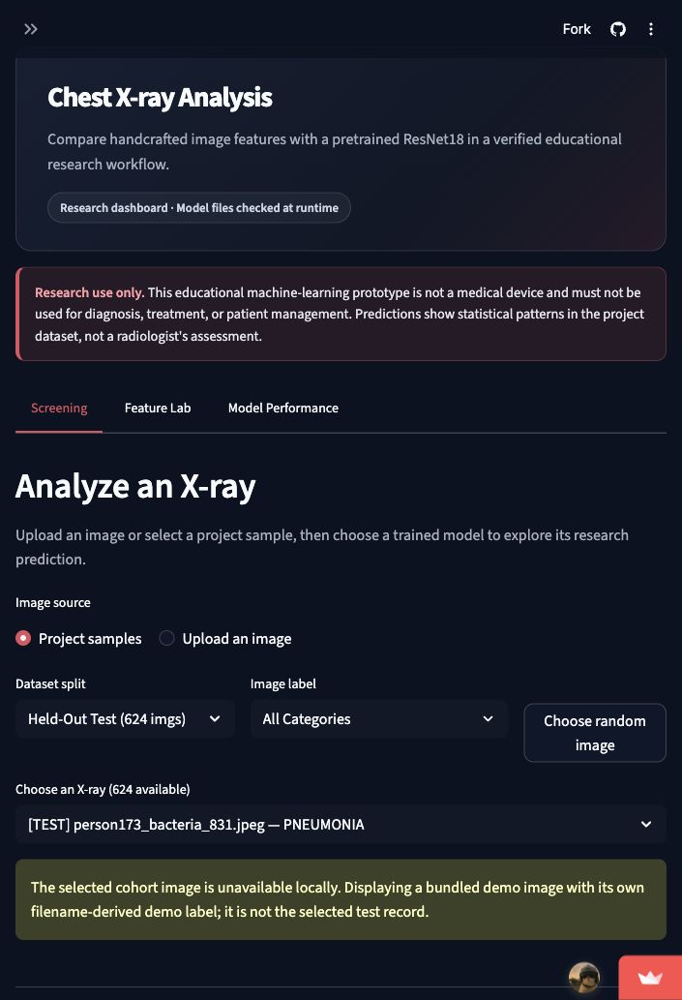
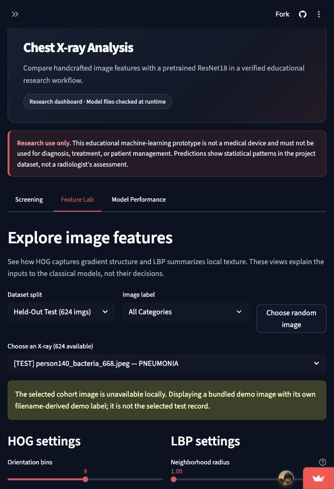
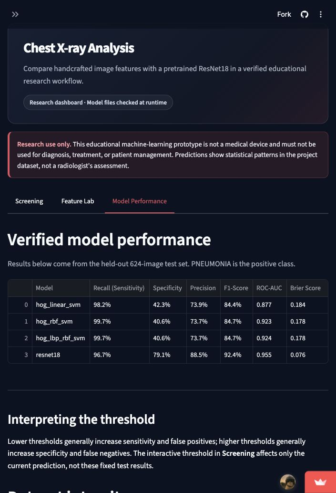
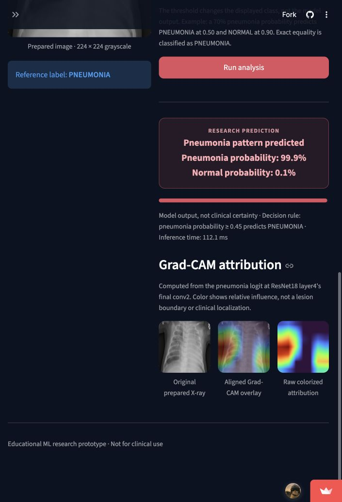
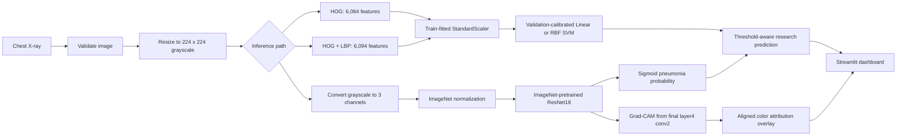

# Pneumonia Screening from Chest X-Rays using Machine Learning and Deep Learning

[](https://www.python.org/)
[](https://pytorch.org/)
[](https://scikit-learn.org/)
[](https://pneumonia-detector-ml-dl.streamlit.app/)
[](#verification)

## [Launch the Live Demo](https://pneumonia-detector-ml-dl.streamlit.app/)

An end-to-end educational research project comparing handcrafted radiographic features with transfer learning for binary pneumonia screening. The repository contains three trained, validation-calibrated SVM pipelines; a trained ImageNet-pretrained ResNet18; real held-out evaluation artifacts; Grad-CAM explainability; automated tests; and a deployed Streamlit application.

> **Medical disclaimer:** This is an educational research prototype, not a medical device. It must not be used for diagnosis, triage, treatment, patient management, or any other clinical decision.

## Live application

The deployed dashboard supports a bundled demonstration image or user upload, all four trained inference paths, an adjustable decision threshold, HOG/LBP feature exploration, verified test metrics, and ResNet18 Grad-CAM. Displayed probabilities are model outputs—not clinical certainty.

| Screening | Feature Lab |
|---|---|
|  |  |
| **Model Performance** | **ResNet18 and Grad-CAM** |
|  |  |

## System architecture



## Verified held-out results

Every value in this table is read from the tracked real-evaluation JSON artifacts. All four models were evaluated on 624 held-out test images: 234 `NORMAL` and 390 `PNEUMONIA`. Pneumonia is the positive class.

| Model | Accuracy | Precision | Sensitivity | Specificity | F1 | ROC-AUC | TN / FP / FN / TP |
|---|---:|---:|---:|---:|---:|---:|---:|
| HOG + Linear SVM | 77.24% | 73.94% | 98.21% | 42.31% | 84.36% | 0.8766 | 99 / 135 / 7 / 383 |
| HOG + RBF SVM | 77.56% | 73.67% | **99.74%** | 40.60% | 84.75% | 0.9234 | 95 / 139 / 1 / 389 |
| HOG + LBP + RBF SVM | 77.56% | 73.67% | **99.74%** | 40.60% | 84.75% | 0.9235 | 95 / 139 / 1 / 389 |
| **ResNet18** | **90.06%** | **88.50%** | 96.67% | **79.06%** | **92.40%** | **0.9551** | 185 / 49 / 13 / 377 |

Sources: [`model_comparison.json`](results/metrics/model_comparison.json) and [`resnet18_test_metrics.json`](results/metrics/resnet18_test_metrics.json).

### Interpreting the trade-off

ResNet18 has the highest accuracy, precision, specificity, F1, balanced accuracy, and ROC-AUC. It is not best at every metric: both RBF SVMs achieve 99.74% sensitivity and miss only one pneumonia image, compared with ResNet18's 96.67% sensitivity and 13 false negatives. That sensitivity comes with approximately 40.60% specificity and 139 false positives. ResNet18 provides a substantially more balanced sensitivity-specificity profile, but the appropriate operating threshold depends on the application and cannot be selected from this single retrospective dataset alone.

The Streamlit threshold changes only the displayed class. It does not change or recompute the underlying pneumonia probability. The decision rule is `pneumonia_probability >= threshold`.

## Dataset and split policy

The project uses the Kaggle [Chest X-Ray Images (Pneumonia)](https://www.kaggle.com/datasets/paultimothymooney/chest-xray-pneumonia) dataset. Raw images are not redistributed in this repository.

The downloaded dataset contained 5,856 readable JPEG images: 5,216 in the original training directory, 16 in the original validation directory, and 624 in the original test directory. Because the original validation split was too small for model selection, the modeling manifest excludes those 16 images, reproducibly partitions the original training directory, and preserves the original test directory untouched.

| Modeling split | Normal | Pneumonia | Total |
|---|---:|---:|---:|
| Train | 1,140 | 3,292 | 4,432 |
| Validation | 201 | 583 | 784 |
| Test | 234 | 390 | 624 |

The stored audit reports zero unreadable images, zero conflicting-label exact duplicates, and zero exact-hash overlap across modeling splits. Exact hashing does not detect near duplicates, and the public filenames do not provide authoritative patient identifiers; therefore, patient-level separation cannot be guaranteed. See [`data/README.md`](data/README.md) for dataset placement and audit details.

## Methodology

### Preprocessing

- Validate input paths and supported image files.
- Convert each X-ray to single-channel grayscale.
- Resize to `224 × 224` pixels.
- Encode `NORMAL = 0` and `PNEUMONIA = 1` consistently.
- Keep train, validation, and test roles separate throughout training and evaluation.

For ResNet18, the grayscale image is repeated across three channels and normalized with ImageNet mean and standard deviation. Training augmentation applies a small rotation and horizontal flip only to the training split.

### Classical machine learning

- **HOG:** 9 orientation bins, `16 × 16` pixels per cell, `2 × 2` cells per block, L2-Hys normalization, producing 6,084 features.
- **LBP:** uniform LBP with `P=8` and `R=1`, producing a normalized 10-bin texture histogram.
- **Scaling:** `StandardScaler` is fitted on training features only and then applied to validation and test features.
- **Selection:** class-balanced Linear and RBF SVM hyperparameters are selected by stratified five-fold cross-validation on training data using balanced accuracy.
- **Calibration:** the selected base estimator is fitted on training data; Platt sigmoid calibration uses validation data only.
- **Evaluation:** calibrated artifacts are frozen before the test caches are opened.

The combined pipeline concatenates scaled HOG and LBP representations. Training details and timings are recorded in [`classical_training.json`](results/metrics/classical_training.json).

### Deep learning

- ImageNet-pretrained ResNet18 with a frozen convolutional backbone.
- Replaced binary classification head with dropout.
- Weighted binary cross-entropy and AdamW optimization.
- Validation-loss checkpointing with early stopping patience of three and a maximum of ten epochs.
- Best checkpoint selected at epoch 9: validation loss `0.07923`, validation accuracy `93.37%`.
- Final held-out evaluation at threshold `0.50` after model selection was complete.

The tracked checkpoint is [`resnet18_best.pt`](results/models/resnet18_best.pt), with its complete epoch history in [`resnet18_best.history.json`](results/models/resnet18_best.history.json).

## Grad-CAM explainability

Grad-CAM is computed from ResNet18 `layer4`'s final `conv2` activation using gradients of the positive-class pneumonia logit. The app shows the prepared X-ray, an aligned color overlay, and the raw normalized heatmap.

Grad-CAM indicates regions that influenced a model score. It is not a lesion segmentation, causal explanation, radiologist annotation, or proof that the model learned clinically valid features. Its spatial resolution is limited by the final convolutional feature map, and visual plausibility does not establish medical correctness.

## Reproduce locally

### 1. Install

```bash
git clone https://github.com/Silence91169/pneumonia-screening-ml-dl.git
cd pneumonia-screening-ml-dl
python3 -m venv .venv
source .venv/bin/activate
python -m pip install --upgrade pip
python -m pip install -r requirements.txt
```

### 2. Place and audit the dataset

Extract the dataset without modifying the source files:

```text
data/raw/chest_xray/
├── train/{NORMAL,PNEUMONIA}/
├── val/{NORMAL,PNEUMONIA}/
└── test/{NORMAL,PNEUMONIA}/
```

```bash
python3 scripts/audit_dataset.py
python3 scripts/prepare_data.py
```

### 3. Extract features, train, and evaluate the SVMs

```bash
python3 scripts/extract_features.py --config all
python3 scripts/train_classical.py
python3 scripts/evaluate.py
```

`evaluate.py` fails closed if a required model or real held-out feature cache is missing; it does not create fallback metrics.

### 4. Train and evaluate ResNet18

```bash
python3 scripts/train_cnn.py --epochs 10 --batch-size 16
python3 scripts/evaluate_cnn.py --batch-size 16
```

The default training run uses ImageNet pretrained weights. Pass `--no-pretrained` only for an explicitly different experiment. The current training script selects CUDA when available and otherwise uses CPU.

### 5. Test and launch Streamlit

```bash
python3 -m pytest -q
streamlit run app.py
```

## Repository structure

```text
.
├── app.py                         # Deployed Streamlit application
├── configs/config.yaml            # Shared preprocessing and feature settings
├── data/
│   ├── README.md                  # Dataset attribution and audit instructions
│   ├── processed/split_manifest.csv
│   └── sample_images/             # Small deployment demonstration set
├── docs/images/                   # Genuine screenshots from the live deployment
├── results/
│   ├── dataset_audit/             # Aggregate data-audit evidence
│   ├── figures/                   # Evaluation plots
│   ├── metrics/                   # Real metrics and provenance records
│   └── models/                    # SVMs, scalers, and ResNet18 checkpoint
├── scripts/                       # Audit, preparation, training, and evaluation CLIs
├── src/                           # Reusable data, feature, model, and metric code
├── tests/                         # Automated regression tests
├── requirements.txt               # Pinned Python dependencies
└── packages.txt                   # Streamlit Cloud system dependencies
```

## Verification

- Real AML evidence marker: `real held-out test features; synthetic fallback prohibited`.
- Real DL evidence marker: `real held-out test images`.
- Three calibrated SVM artifacts, two train-fitted scalers, and the epoch-9 ResNet18 checkpoint load in the deployed app.
- Automated suite: **59 tests passed**.
- Fresh screenshots above were captured from the public Streamlit deployment on 16 November 2026 and reviewed for sensitive content.

## Limitations and responsible use

- Results are retrospective and come from one public pediatric dataset.
- Dataset imbalance and distribution-specific acquisition can inflate or distort apparent performance.
- Patient-level separation is not established from the available metadata.
- The SVMs' high sensitivity is accompanied by many false positives and low specificity.
- Thresholds and probability calibration may not transfer to other institutions or populations.
- The binary label does not identify pneumonia cause, severity, comorbidities, or alternative pathology.
- External, prospective, multi-site validation and clinical governance would be mandatory before any real-world use.

This repository demonstrates a reproducible ML engineering and research workflow; it does not establish clinical validity.
