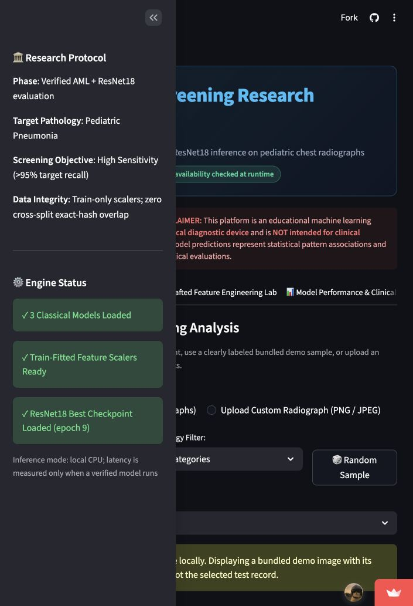
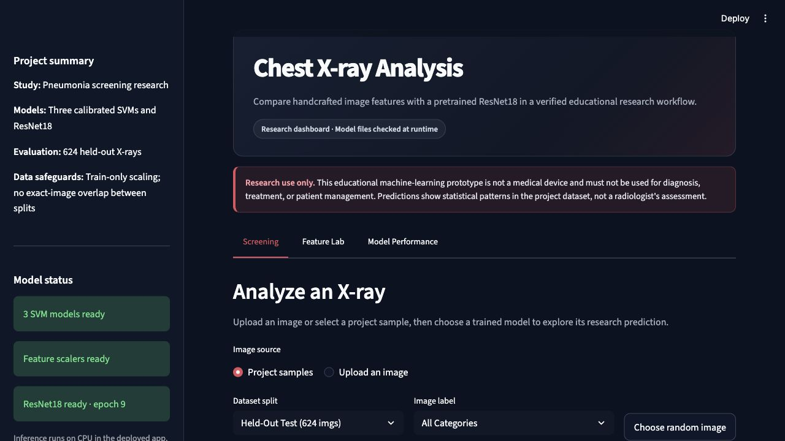
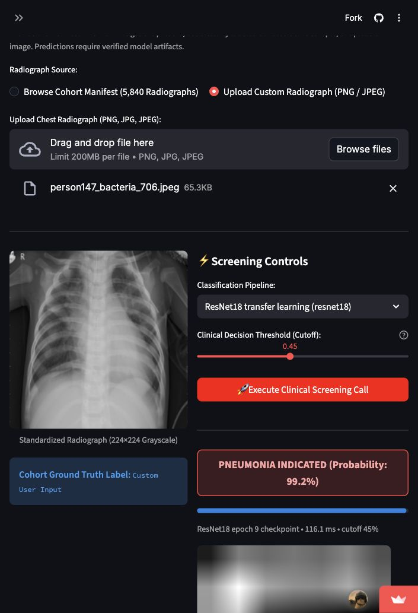
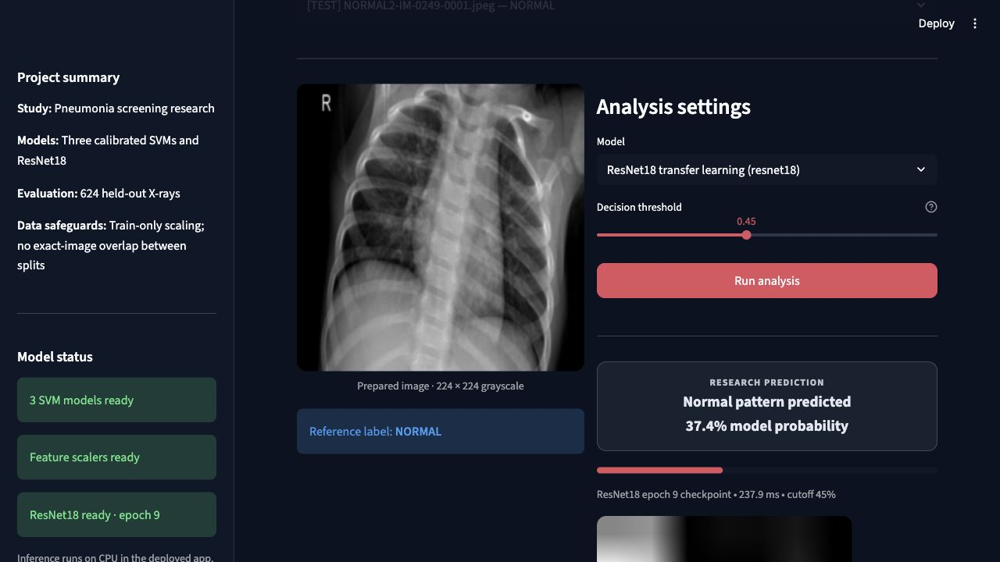
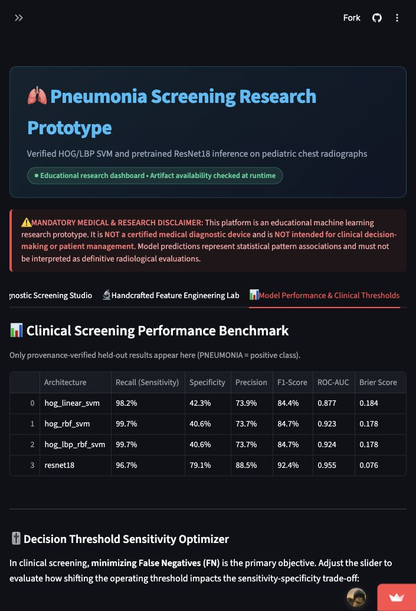
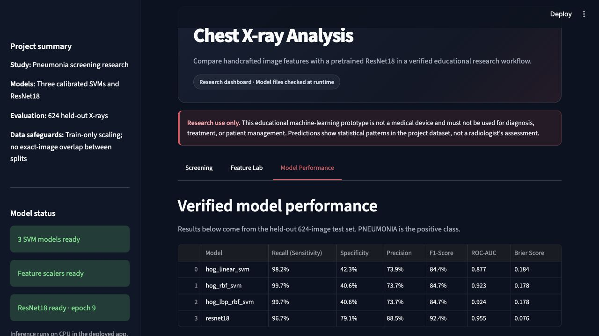

# Streamlit UI refresh evidence

These screenshots document the interface before and after the `design/streamlit-ui-refresh` change. The before images were captured from the deployed `main` application. The after images were captured from the redesigned branch running locally against the same tracked model artifacts.

The redesigned branch has not been deployed; these images do not claim live-deployment verification.

## Dashboard

| Before (`main`, live) | After (`design/streamlit-ui-refresh`, local) |
|---|---|
|  |  |

## ResNet18 and Grad-CAM

| Before (`main`, live) | After (`design/streamlit-ui-refresh`, local) |
|---|---|
|  |  |

## Model performance

| Before (`main`, live) | After (`design/streamlit-ui-refresh`, local) |
|---|---|
|  |  |
